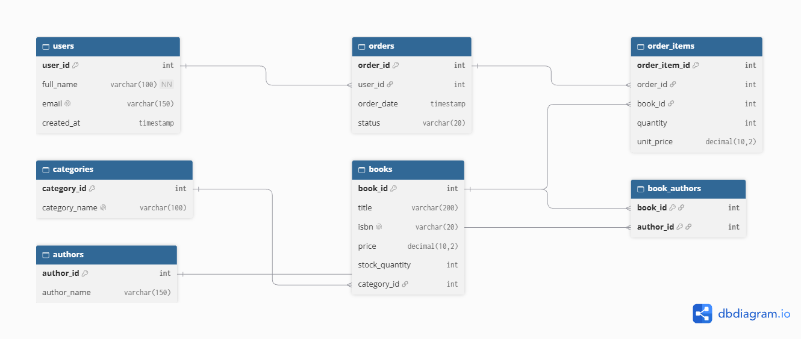

# Online Bookstore Database Design

## 1. Project Overview

The Online Bookstore Database is a relational database management system designed to manage an online bookstore.

It stores information about customers, books, authors, categories, and customer orders. The database helps maintain organized records and establishes relationships between different entities.

The database is implemented using MySQL and follows Third Normal Form (3NF) to reduce data duplication and maintain data consistency.

## 2. Technologies Used

- Database: MySQL
- Database Tool: MySQL Workbench
- ER Diagram: dbdiagram.io
- Documentation: Markdown
- Version Control: Git and GitHub

## 3. Database Tables

The database contains seven tables:

| Table Name   | Description                           |
| ------------ | ------------------------------------- |
| users        | Stores customer information           |
| categories   | Stores book categories                |
| books        | Stores book details                   |
| authors      | Stores author information             |
| book_authors | Connects books and authors            |
| orders       | Stores customer order details         |
| order_items  | Stores individual books in each order |

## 4. Entity Relationship Diagram (ERD)

The ER diagram represents all seven tables and their relationships.

## 5. Database Relationships

The database contains the following relationships:

1. Users and Orders: One-to-Many.
2. Categories and Books: One-to-Many.
3. Orders and Order Items: One-to-Many.
4. Books and Order Items: One-to-Many.
5. Books and Authors: Many-to-Many.

The Many-to-Many relationship between Books and Authors is implemented using the `book_authors` junction table.

## 6. Database Normalization

The database follows Third Normal Form (3NF).

### First Normal Form (1NF)

Each column contains atomic values, and there are no repeating groups or multiple values in a single column.

### Second Normal Form (2NF)

The database follows 1NF, and every non-key attribute depends on the entire candidate key. The `book_authors` junction table uses a composite primary key.

### Third Normal Form (3NF)

The database follows 2NF and avoids transitive dependencies. For example, category information is stored separately in the categories table instead of repeating category names in the books table.

## 7. Primary Keys and Foreign Keys

Primary keys uniquely identify records in each table.

Foreign keys establish relationships between tables and maintain referential integrity.

The `book_authors` table uses a composite primary key consisting of `book_id` and `author_id`.

## 8. Indexes and Constraints

The database uses:

- PRIMARY KEY constraints for unique identification.
- FOREIGN KEY constraints for table relationships.
- UNIQUE constraints to prevent duplicate emails, ISBNs, and category names.
- CHECK constraints to validate prices, quantities, stock, and order status.
- INDEX constraints to improve query performance.

The `order_items` table also uses a unique constraint on `(order_id, book_id)` to prevent duplicate book entries within the same order.

## 9. Sample Data and Testing

Sample records are inserted into all seven tables.

The database is tested using:

- SELECT queries.
- INNER JOIN queries.
- Foreign key validation.
- Primary key verification.
- Index verification.
- Aggregate functions such as SUM().

The order total is calculated using:

`SUM(quantity * unit_price)`

## 10. Project Files

| File                    | Description                         |
| ----------------------- | ----------------------------------- |
| README.md               | Project documentation               |
| schema.sql              | Database and table creation queries |
| sample_data.sql         | Sample records                      |
| test_queries.sql        | Database testing queries            |
| online_bookstore_er.png | Entity Relationship Diagram         |

## 11. Conclusion

The Online Bookstore Database demonstrates relational database design, normalization, primary keys, foreign keys, indexes, and different types of relationships.

It provides a structured way to manage bookstore information while maintaining data consistency and integrity.

## 12. Author

Anuja Kokitkar

Project: Online Bookstore Database Design
